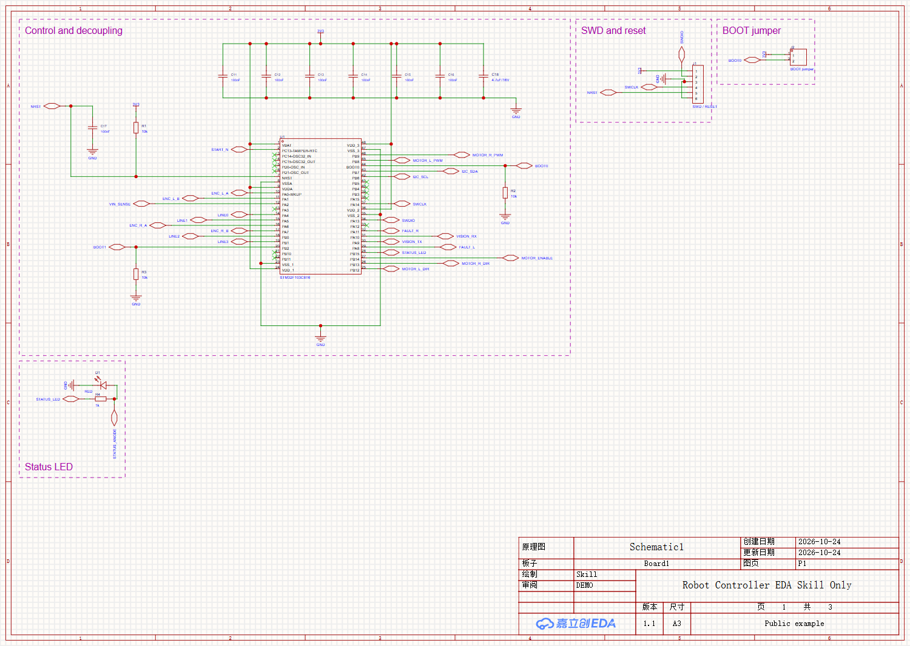
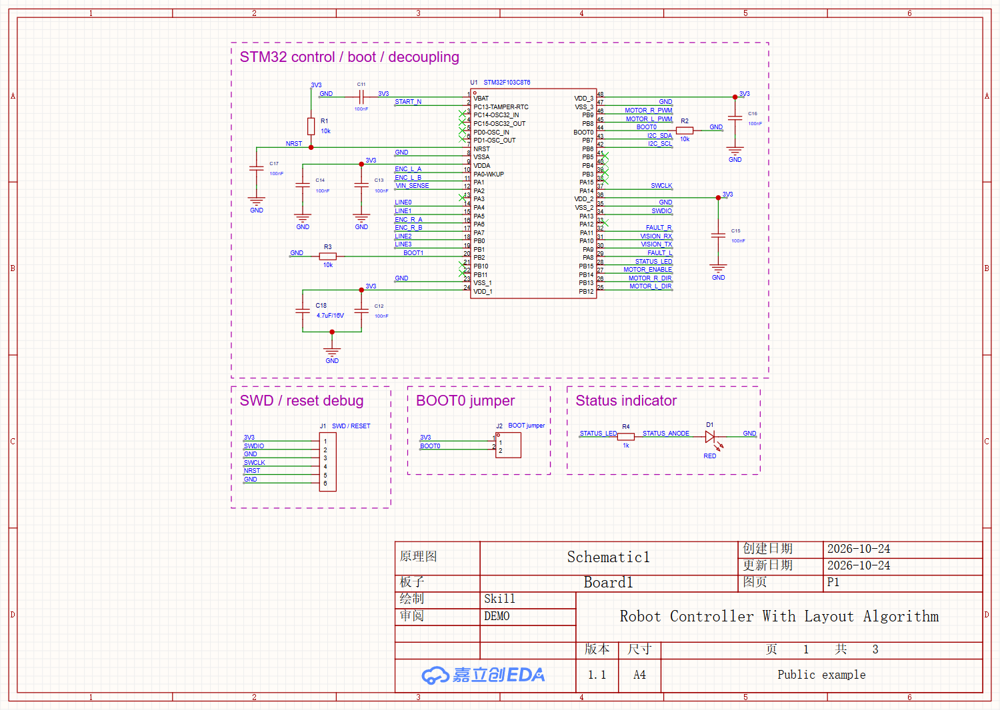
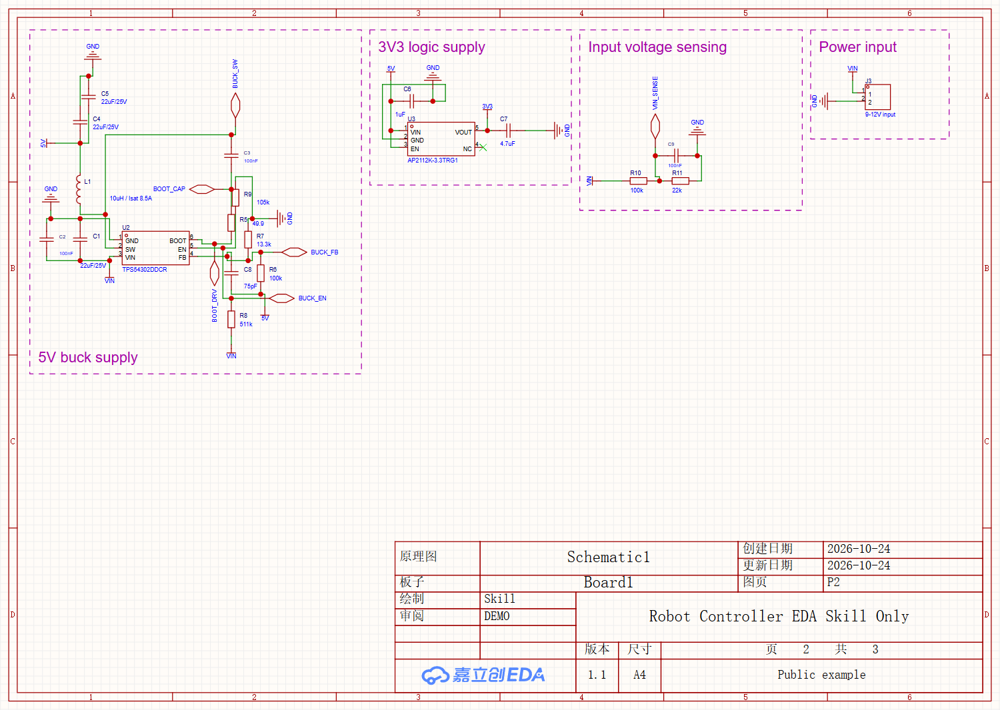
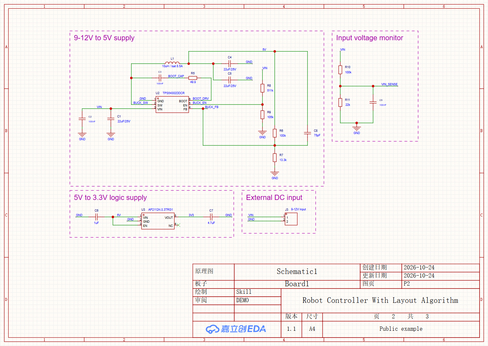
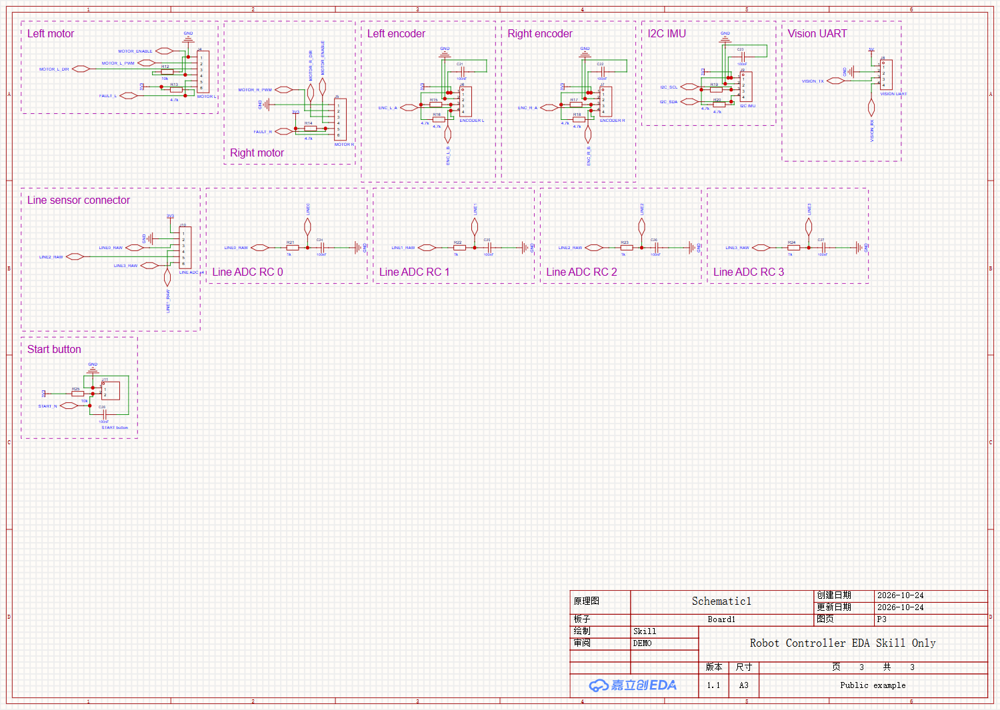
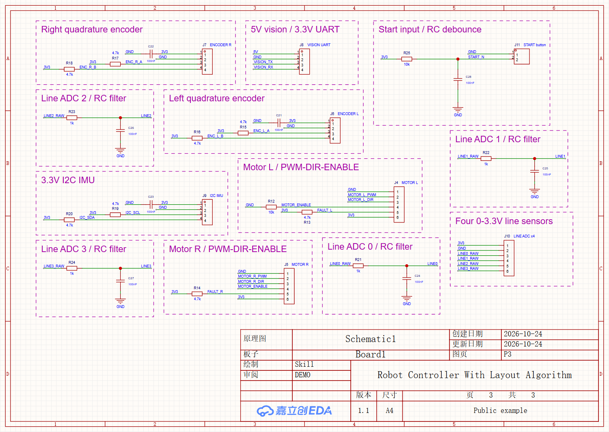

# 电赛小车：仅 EDA skill 与加入排版算法的实际对比

全新独立公开测试：三页、20 个功能模块、66 个真实库元件、209 个物理引脚、13 个 NC。包括 STM32 主控/去耦/复位/BOOT/SWD、9–12V 转 5V、3.3V 逻辑电源、电压采样、双电机控制接口、双编码器、IMU、视觉 UART、四路循迹 RC 和启动按键。电机接口须外接驱动模块，不含功率桥。

## 这次比较什么

**前：只用已安装的 `easyeda-agent v1.14.0` 绘图 skill 和工具，完成正常设计与审查。后：把实际保存的前版导入新工程，加入 `schematic-layout-optimizer 1.1.0`。** 比较的是原理图排版，未做 PCB 铜走线。这里没有证据表明所用 skill 由嘉立创官方发布；其来源见 [easyeda-agent](https://github.com/zhoushoujianwork/easyeda-agent)。

基线由独立试用过程生成，没有读取自定义排版包、它的模板或候选。19 个模块由原生 CLI 常规有界求解得到；主控模块多次正常求解后未完成，依照该 skill 允许的 Agent authored compose 方法完成。正常尝试方向、分区和纸张，保留失败；没有人为调差初始参数、强制不利方向、夸张展开或用同名标签替代必需实线。原生审查后只移动 15 个 Name 属性，修好文字碰撞。三页 compose 重算字节一致。

后版从这份真实基线读取库身份、逐脚网络、NC 和实测几何，再使用可复用功能模板与有限位置/朝向候选、文字避让、正交直连、评分和装箱。它需要 Agent 制定模板，不是任意电路的一键全自动求解器。元件朝向由完整包络和连接决定，没有“电容必须横放”规则。两版器件、值、网络、分页及原有文字字号一致，功能标题均为 20 raw；纸张根据实际可用区选择，后版整体居中。

## 实际导图指标

| 页 | 纸张 | 几何折点 | 去重线长 raw | 内容包络 raw² |
|---|---|---:|---:|---:|
| 1 | A3 → A4 | 18 → 5 | 7190 → 4540 | 1199317.6 → 329069.2 |
| 2 | A4 → A4 | 37 → 13 | 1940 → 3050 | 399204.5 → 385045.4 |
| 3 | A3 → A4 | 70 → 0 | 3675 → 4985 | 995844.5 → 570925.0 |

三页合计：折点 **125 → 18（减少 85.6%）**；线长 **12805 → 12575（减少 1.8%）**；内容包络之和 **2594366.5 → 1285039.5（减少 50.47%）**。两张 A3 和一张 A4 改为三张 A4。

**第 2、3 页线长增加**，因此不能说所有页面或所有指标都改善。此例主要改善整体占用与折点；只是一套电路的描述性结果，不代表厂商能力排名或全局最优。

折点统一定义为去重线段图中恰有两条相邻边且转向 90° 的节点；T/X 分支不计为折点。线长对重合共线区间取并集，包含网络标记引线。内容包络包含元件/标记本体、全部非图框文字及导线，排除纸张、图签和装饰模块矩形。两版均对保存重载后的真实数据运行相同统计；不能与模板报告的“每条路径累计折点”混用。

## 看效果

下载本例后打开 [preview.html](preview.html)，默认共同坐标比例，可切页、适合窗口或按原始比例查看。下列 PNG 是各自整页宽度的渲染，A3/A4 缩放不同；比较字号请用预览的共同坐标比例或原始 SVG。

共同坐标比例的整页截图：[主控对比](comparison-1.png)、[电源对比](comparison-2.png)、[接口对比](comparison-3.png)。

| 页 | 仅 EDA skill | 加入排版算法 |
|---|---|---|
| 01 主控与调试 |  |  |
| 02 电源与采样 |  |  |
| 03 运动与传感器 |  |  |

## 程序、重现与 API

- `baseline-N-composition.json` / `baseline-N-plan.json`：原生 skill 的完整离线输入与输出；从本目录运行 `easyeda sch compose --from baseline-1-composition.json --out ./replay-1.json`，其余两页同理。原生 compose 不包含最后 15 处 Name 的人工审查位置，实际基线以 `before-*-readback.json` / SVG 为准。
- `source.json`：实际基线导出的元件、网络、NC 与 SVG 字形模型；`measurements.json`：同字体环境下浏览器 `getBBox()` 实测数据；`layout-after.json`：功能模板、全部候选、约束、纸张与权重。从 skill 根目录运行 `python scripts/layout.py build --manifest examples/robot-controller/layout-after.json --out ./robot-rebuild`。
- 两版实际写入均使用 typed 原生接口：`schematic.component.modify`、`schematic.pin.set_no_connect`、`schematic.wire.create`、网络标记、`schematic.attribute.move`、`sch frame apply`、保存及文档重载。基线网络标记由原生 `schematic.power.connect_pin` 生成。当前受保护 compose Apply 编译被 CLI/连接器 primitive inventory 兼容问题拒绝，错误已保留；实际基线在全新无导线页中按完整 plan 加法执行，没有删除原始快照字段或放宽守卫。不能把离线成功称为该队列通过。
- `before.epro2` / `after.epro2`：原生工程分享副本，请导入为新工程。快照、逐脚/文字检查、原生严格门禁及 `comparison.json` 分别给出证据。独立工具 `measure_metrics.py` 只做统计；先用 skill 的 `measure` 命令从 SVG 重新生成测量，再运行 `python measure_metrics.py before-1-readback.json measured.json before-1.svg`。

算法源码和依赖见 [程序与算法](../../references/software-and-algorithms.md)。没有使用商业自动布线器或 AI 生图。原理图截图来自真实 EDA SVG 的浏览器渲染。

## 验证与隐私

两版均已保存、重载、重新读取并逐脚核对 net/NC；基线最终全页文字、导线与文字、其他本体与文字相交检测均为 0。后版另外核对保留身份、实际导线覆盖、必需直连和全部可见文字。严格原生门禁仍有属性匹配及版面提示，保留全部报告，不能称为 DRC 全通过。电源预算、接口兼容性、PCB、制造和硬件未验证。

只公开这份已获授权的全新测试数据。分享副本清除作者账号对象、本机路径及 Logo 递归嵌入 SVG 的隐藏联系信息，保留可见几何；原始观测留在本地，不改写验证输入。分享 SVG 是元数据清理副本，不能声称其字节未经修改；清理前后按同一浏览器渲染核对。原生工程清理保留电路与库绑定，导入后宿主会重新分配部分会话信息。

器件资料来源：[ST STM32F103x8/B](https://www.st.com/resource/en/datasheet/stm32f103c8.pdf)、[TI TPS54302](https://www.ti.com/lit/ds/symlink/tps54302.pdf)、[Diodes AP2112](https://www.diodes.com/assets/Datasheets/AP2112.pdf)。资料只支持选型/引脚核对，不证明本例已经原厂或硬件验证。
